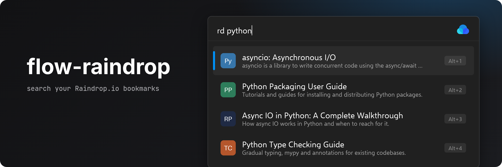

<!-- generated by readwright from docs/README.md.j2; edit the template, not this file -->


# Flow-Raindrop

Search your Raindrop.io bookmarks from Flow Launcher.

[](https://github.com/Garulf/Flow-Raindrop/actions/workflows/tests.yml) [](https://github.com/Garulf/Flow-Raindrop/releases/latest) [](https://github.com/Garulf/Flow-Raindrop/releases/latest)

[](https://www.buymeacoffee.com/garulf) [](https://github.com/sponsors/Garulf)

## Features

* **Search every collection.** Queries go to Raindrop.io's own search, across all your collections.
* **Open with `Enter`.** The bookmark opens in your default browser.
* **Cached results.** Repeat searches are answered from a local cache for as long as you choose.

## Usage

Type `rd` followed by what you're looking for:

```
rd python
```


### Context menu

Open the context menu (`Shift+Enter` or right-click) on any result to open Raindrop.io in your
browser or clear the cached search results:


## Installation

### Flow Launcher

In Flow Launcher, type:

```
pm install FlowRaindrop
```


### Manual installation

Download `Flow-Raindrop-<version>.zip` from the [latest release](https://github.com/Garulf/Flow-Raindrop/releases/latest) and unzip it into
`%appdata%\FlowLauncher\Plugins`, then restart Flow Launcher.

Pre-releases of the next version are published from the open release PR on the
[releases page](https://github.com/Garulf/Flow-Raindrop/releases) for testing. Flow Launcher won't offer them as updates.

## Configuration

The plugin needs a Raindrop.io API token. Until you add one, every search shows this:


To get a token:

1. Open [Raindrop.io integrations settings](https://app.raindrop.io/settings/integrations).
2. Under **For Developers**, choose **Create new app**, give it any name and accept the terms.
3. Open the app and copy its **Test token**. The client ID and client secret won't work here.

Then open **Settings → Plugins → FlowRaindrop** in Flow Launcher:

| Setting | Default | Description |
| --- | --- | --- |
| API Token | | Your Raindrop.io test token |
| Cache duration | `5 minutes` | How long search results are reused before asking Raindrop.io again |

## Requirements

* Flow Launcher 1.17.0 or newer
* Python 3.8 or newer, which Flow Launcher can install for you

## Changelog

### [1.0.0](https://github.com/Garulf/Flow-Raindrop/compare/v0.0.2...v1.0.0) (2024-02-16)

#### Features

* use pyFlowLauncher instead of Flox
* talk to the Raindrop.io API directly instead of through an external library
* cache API responses, with a configurable cache duration

### [0.0.2](https://github.com/Garulf/Flow-Raindrop/compare/v0.0.1...v0.0.2) (2022-03-23)

#### Bug Fixes

* update requirements

### 0.0.1 (2022-03-23)

First release.

See [CHANGELOG.md](CHANGELOG.md) for the full history.
